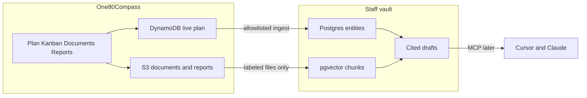

# One80Compass — Unified release plan

*Single plan for the portal product and the staff AI vault. Version 1.17 — 2026-10-29.*

This document **combines**:

1. `One80Labs_Portal_Implementation_Plan_v7.5.md` (product release boundaries and workstreams)
2. The AI vault architecture Cursor plan (Compass owns live work + staff Postgres vault)

Use this file as the release plan. The v7.5 implementation plan remains historical reference; the Cursor plan mirrors the todos below for agent execution.

---

## Status at a glance

| Area | Status |
| --- | --- |
| R1 MVP (portal core in AWS dev) | **Complete** |
| R2 Project Management + Compass ownership (Phases 1–6) | **Complete** |
| R3 vault core (Phases 7–9) — Postgres, ingest, cited draft | **Complete** (deployed) |
| R3 Phase 10 — Staff vault MCP | **Complete** (`services/vault-mcp`; beginner SOP; `GET …/vault-chunks`) |
| R3 backlog — ingest UI, upload-triggered ingest, scheduled ingest, richer ontology | **Complete** |
| Absolute 2-hour browser session sign-out | **Complete** (auth_time + Cognito refresh 2h) |
| R1 pilot / first external customer gate | **Not started** |
| Security hardening follow-ups (Oct 2026 review) | **Complete** (COMP-31 Secrets Manager done; MFA REQUIRED cutover remains for stage/prod; 2h session Done) |
| Gantt dependency enhancements (post-v1) | **Complete** |
| Sidebar FAQ beginner guides (all roles) | **Complete** |
| Decision Register (Project Plan) | **In progress** — register and plan marker shipped; suggestion inbox not started |
| R4 Recovery & Governance | **Not started** |

---

## 1. Delivery objective

Ship a secure, customer-ready One80Compass portal (Documents, Project Plan, Kanban, Status Reports) and a **staff-only** AI vault that can cite filed evidence. Deliver in thin vertical slices. Advanced capabilities stay on the committed backlog, not MVP blockers.

Customers do not log into the vault. A per-customer AI feature is a later release.

---

## 2. Architecture decisions (current)

| Topic | Decision |
| --- | --- |
| Live plan | DynamoDB (`one80compass-dev`). After import, a project may be `recordSource: compass` and stop writing back to GitHub Projects. |
| Code host | Git repository, PRs, and CI stay on GitHub. |
| GitHub Projects | Source only while `recordSource` is `github`. Optional sync; no write-back after Compass owns the project. |
| Staff vault | Aurora PostgreSQL Serverless v2 + pgvector. Rebuildable copy of allowlisted programs + labeled filed files. |
| Vault IAM | Vault Lambda holds Data API / secret / Bedrock. API may only `InvokeFunction` the vault Lambda. |
| Drafts | Cited status drafts do not change live plan dates or status. Humans review before publish. |
| Tenant isolation | Every vault row keeps `customerId` and `programId` (Compass project id). |

ADRs: [0011](../adr/0011-compass-owns-live-work.md), [0012](../adr/0012-staff-vault.md). SOP: [staff-vault.md](../sop/staff-vault.md).

---

## 3. Release boundaries

| Release | In scope | Status | Exit / value |
| --- | --- | --- | --- |
| **R1 — MVP** | Cognito, tenant isolation, admin, navigation, Overview, Documents, GitHub-connected plan/Kanban, progress, basic milestones, manual reports, soft delete, audit | **Complete** in AWS dev | Pilot can complete main workflows without Confluence |
| **R2 — Project Management** | Hierarchy, Gantt/timeline, dependencies, baselines, milestones, Compass-owned catalogs and full issue editor, GitHub → Compass import | **Complete** in AWS dev | Schedule usable in reviews; Compass can own live work |
| **R3 — AI & Automation** | Staff vault (Postgres, ingest, cited draft), vault MCP, allowlist/ingest UX, richer ontology | **Complete** (7–10 + backlog UX/ontology) | Staff AI drafts are auditable; agents use the vault via MCP (`services/vault-mcp`) |
| **R4 — Recovery & Governance** | Selective restore, bulk partial success, conflict retries, advanced document governance | **Not started** | Rich recovery without overwriting active work |

---

## 4. Completed work

### A — Foundation & Security (R1) — Complete

- [x] Repo, CDK IaC, Cognito, admin group, tenant-scoped API
- [x] React shell, protected routes, CloudFront site (https://one80compass.ai)

### B — Portal & Application Directory (R1) — Complete

- [x] Customer/project CRUD, Overview health/notes, application links

### C — Documents & Audit (R1) — Complete

- [x] S3 upload/download/folders/versions, soft delete/restore, audit
- [x] Document vault source labels (`compass-upload`, `krisp`, `fireflies`, `other`)

### D — Plan, Kanban & Compass ownership (R1–R2) — Complete

Vault-track Phases 1–6:

| Phase | Work | Status |
| --- | --- | --- |
| 1 | ADR 0011 — Compass owns live work | **Complete** |
| 2 | DynamoDB field parity (priority, labels, relationships, catalogs) | **Complete** |
| 3 | `recordSource` compass writes (no GitHub enqueue) | **Complete** |
| 4 | Admin catalog screens (Settings → Catalog) | **Complete** |
| 5 | Full Compass issue editor + label/type colors | **Complete** |
| 6 | Import GitHub project → `recordSource: compass` | **Complete** |

Also complete in app:

- [x] GitHub App sync for `recordSource: github` projects
- [x] Timeline/Gantt, dependencies, baselines, milestones, progress
- [x] Hard Blocker vs soft Dependency (v1); post-v1 lag/kinds/critical path/hover/auto-reschedule (§5 I)
- [x] Catalog colors for labels (tag border) and issue types (Gantt bar)
- [x] Sidebar FAQ beginner guides for all roles (§5 J)

### E — Status Reports (R1) — Complete

- [x] Draft → submit → approve → publish; Overview integration
- [x] Publish may store report markdown in the documents bucket

### F — Staff vault core (R3) — Complete (deployed)

| Phase | Work | Status |
| --- | --- | --- |
| 7 | Aurora PostgreSQL 16.8 + pgvector, vault Lambda, schema on deploy, secret `one80compass-dev-vault` | **Complete** |
| 8 | Allowlist + ingest (plan + labeled files); API invokes vault Lambda; customer/program filter | **Complete** |
| 9 | Cited status draft (“Draft from vault”); no live-plan mutation | **Complete** |

Staff SOP: [docs/sop/staff-vault.md](../sop/staff-vault.md).

---

## 5. Open work

### G — Pilot & production readiness (R1 gate) — Not started

- [ ] Threat model tenant separation and portal-to-Lambda access
- [ ] Recovery, migration, and GitHub failure drills
- [ ] Accessibility and mobile verification pass
- [ ] Monitoring/alerts proven for critical paths
- [ ] Pilot with one test customer; retire associated Confluence links

### G2 — Security hardening follow-ups (Oct 2026 review) — Complete

Code review + security scan closed Critical/High defects, then this slice landed the remaining G2 items (including **COMP-31** GitHub App PEM / webhook secret → Secrets Manager). Stage/prod Cognito should still use `Mfa.REQUIRED` on a stack without password-only admins (dev stays `OPTIONAL` with software tokens).

| Item | Severity | Notes | Status |
| --- | --- | --- | --- |
| Cognito MFA on live DNS | Critical | Dev stack: `Mfa.OPTIONAL` + software OTP. Stage/prod must use `REQUIRED` on a stack without password-only admins | **Done** (code; REQUIRED cutover is stage/prod) |
| GitHub secrets in Secrets Manager (COMP-31) | Critical | Secret `one80compass-dev-github`; Lambdas read `GITHUB_SECRET_ARN`; PEM not in Lambda env | **Done** |
| DynamoDB query pagination | High | `queryAll` / `queryUpTo` in `services/api/src/store.ts` (shared with sync) | **Done** |
| Baseline number concurrency | High | `BASELINE_SEQ` ADD + conditional put; `409` on race | **Done** |
| Prod CORS without localhost | Medium | `BROWSER_ORIGINS` / `prodOriginsOnly` / `PROD_ORIGINS_ONLY` → only `https://one80compass.ai` (+ www) | **Done** |
| RETAIN + PITR for prod data | High | Cognito, Dynamo, documents: `RETAIN`; documents no auto-delete; Dynamo PITR on | **Done** |
| Encrypt SQS / SNS | Medium | Sync queue + DLQ SQS-managed SSE; alerts topic `alias/aws/sns` | **Done** |
| Client ID token refresh | High | `freshIdToken()` / `refreshSession()`; `api()` refreshes before fetch and once on 401 | **Done** |
| Absolute 2-hour session sign-out | Medium | Absolute window from Cognito `auth_time` (not idle): web timer + `restoreSession`/`refreshSession` clear; `api()` does not fall back after Cognito sign-out; Cognito app-client `refreshTokenValidity` = 2h (`infra/lib/dev-stack.ts`) | **Done** |
| Vault chunk ids tenant-scoped | Medium | PK = `customerId:programId:documentId:versionId:index` | **Done** |
| GitHub reconcile page beyond ~1000 | Medium | Page until complete (cap ~10k); fail loudly; assignees/blockedBy truncated → fail | **Done** |
| Customer audit PII scope | Medium | Non-admins: metadata only (`before`/`after` null) on customer audit + overview activity; admins full | **Done** |
| Report approve/publish roles | Medium | Approve/publish platform-admin only; contributors draft/submit/revise | **Done** |

### H — Release backlog (R3+) — Partially complete

| Item | Notes | Status |
| --- | --- | --- |
| **Phase 10 — Staff vault MCP** | Cursor/Claude via `services/vault-mcp`: tools `vault_get_allowlist`, `vault_set_allowlist`, `vault_ingest`, `vault_list_chunks`, `vault_draft_status`. Admin auth; portal API only (no Aurora in MCP). | **Done** |
| Admin `GET …/vault-chunks` | List filed chunks for an allowlisted program (embeddings stripped); used by MCP list/search | **Done** |
| MCP registration + beginner SOP | `docs/sop/staff-vault.md` registration; `docs/sop/vault-mcp-beginner.md` install/use guide; `services/vault-mcp/README.md` | **Done** |
| Allowlist / ingest UI in Compass | Admin Documents panel; `GET`/`PUT .../vault-allowlist`, `POST .../vault-ingest` | **Done** |
| Upload-triggered ingest | Auto re-ingest on labeled upload complete / sourceLabel change for allowlisted programs; manual POST remains | **Done** |
| EventBridge / cron scheduled ingest | 15-minute rule `VaultIngest` re-ingests every allowlisted program so plan-only edits land without a document upload; enabling the allowlist best-effort re-ingests that program | **Done** |
| Richer ontology | Populate risks, decisions, people; multi-hop retrieval via relations | **Done** |
| Customer-login AI | Separate product later | Out of scope |
| Live Krisp / Fireflies connectors | File exports only for now | Out of scope |
| GitHub export from Compass | — | Out of scope |
| Model changes to live plan | Forbidden | Out of scope |
| R4 recovery features | Per original R4 boundary | Not started |

### I — Gantt dependency enhancements (post-v1) — Complete

Hard Blocker vs soft Dependency v1 shipped. Post-v1 backlog (also ADR 0007 Follow-ups) delivered:

| Item | Notes | Status |
| --- | --- | --- |
| Hover when lines hidden | Temporarily show a bar’s connectors / linked bars without turning the global toggle on | **Done** |
| Lag / lead days | Hard Blocker successor starts N days after constraint (+ lag / − lead) via `blockerEdges` | **Done** |
| Other link kinds | Start-to-start, finish-to-finish, start-to-finish (with FS default) | **Done** |
| Critical path | Highlight longest Hard Blocker path on Timeline | **Done** |
| Optional auto-reschedule on Blocker create | Offer existing dependency-review move flow; warn-only remains default | **Done** |

### J — Sidebar FAQ beginner guides — Complete

Moved FAQ out of Settings onto the main sidebar (`/help`) so **View**, **Contributor**, and **Administrator** can open guides. Markdown SOPs under `docs/sop/` are embedded as FAQ tiles with in-app `faq:` cross-links (`?guide=` deep links).

| Item | Notes | Status |
| --- | --- | --- |
| FAQ on main nav (all roles) | Sidebar label **FAQ** → `/help`; removed from Settings | **Done** |
| Timeline / Gantt guide | Bars, drag dates, dependency-lines toggle, hover-reveal | **Done** |
| Dependencies & Blockers guide | Soft vs Hard, lag/lead, FS/SS/FF/SF, optional auto-reschedule | **Done** |
| Critical path guide | Timeline toggle; Hard Blocker graph only | **Done** |
| Baselines guide | Baseline 1, proposals, approve/reject, comparison | **Done** |
| Plan hierarchy guide | Epic → Feature → Task / Subtask | **Done** |
| Risk Register guide | Live blocker conflicts; admin edit fields | **Done** |
| Documents & labeling guide | Upload, versions, recycle bin, vault source labels | **Done** |
| Staff vault user guide | `docs/sop/staff-vault-user-guide.md` on FAQ (`?guide=staff-vault`): label, allowlist, ingest, cited draft | **Done** |
| In-app `faq:` cross-links | Tile switching inside the viewer; Staff vault and MCP tiles remain admin-focused | **Done** |

### K — Decision Register — In progress

Track outstanding questions and the decisions those questions become, tied to one Epic, Feature, or Task. The register, the detail drawer, and the plan-edit marker are in the app. The suggestion inbox is not started. Sits under **R2 — Project Management** on the One80Compass Dev plan. R2 Phases 1–6 stay complete.

View can read, including the source quote and file. Contributors add, edit, comment, resolve, and mark duplicates. Administrators archive. Archive requires a reason. A duplicate points at the surviving item.

One record. Kind is Question or Decision. Status is Outstanding, Resolved, Duplicate, or Archive. Promoting a question keeps the same id and appends a history event. Type 1 (hard to undo) and Type 2 (reversible) apply only to decisions, with who decided and when.

Every item: statement, raised by, raised on, assignees (people on the project), needed from (free text), target date, affects (requirements, direction, timeline, functionality, resources), blocks the linked work, one work-item link, source (kind, quote, speaker, location, when, document), comments. Questions store an answer. Decisions store an outcome and a rationale. History covers status, kind, assignee, target date, outcome, rationale, and the work-item link.

When a question becomes a decision, also record who was consulted, the assumptions, what would change the decision, and what the decision does not mean.

Home screen is a filterable register, not a Kanban board. Header counts: outstanding, overdue, blocking. Assigned-to-me lists outstanding items for the signed-in assignee, overdue first. Default filter is Outstanding. The same drawer adds, edits, and opens from the plan edit screen. That screen shows a count, and a warning when a linked item is outstanding and blocking.

No email alerts. No live email, Teams, or transcript connectors. The suggestion inbox is the next slice: proposals from labeled transcript text (kind, work item, assignee, target date). Hypothetical or already-rejected remarks are labeled and are not a normal Accept. Nothing enters the register until a person accepts it. Accept does not create a plan issue. If the text is edited, keep the original suggestion beside it.

Leave out a pros/cons table, architecture notes that do not affect the project, an informed list, and a PDF export. Options considered, a review-by date, superseded-by, and resulted-in work items come after the first screen.

| Item | Notes | Status |
| --- | --- | --- |
| Build Requirements | Accepted requirements are this section | **Done** |
| Evaluate how Decisions are used in Vault | Recommendation: the register is the source of vault decision rows; stop using issue type Decision. Ingest still uses that convention until a later change | **Done** |
| Register screen | Filterable register, detail drawer, manual source, and the plan-edit count and blocking warning | **Done** |
| Suggestion inbox | Proposals from labeled transcript text. A person accepts or dismisses. Accept does not create a plan issue | **Not started** |

---

## 6. Phase 10 exit criteria — Complete

MCP server for Cursor/Claude: package `services/vault-mcp`.

- [x] Tools: allowlist/clear, ingest, search/list chunks (`program_id`), optional cited draft
- [x] Admin authentication only (`one80-admin` ID token)
- [x] Tenant filter via portal API (`customerId` + `programId`); no cross-tenant rows
- [x] Portal admin API only — no Aurora credentials in the MCP process
- [x] Cursor and Claude Desktop registration documented (`docs/sop/staff-vault.md`, `services/vault-mcp/README.md`)
- [x] Beginner install/use guide (`docs/sop/vault-mcp-beginner.md`)
- [x] Admin `GET /projects/:projectId/vault-chunks` for list/search

**Exit met:** Admin can allowlist, ingest, list/search chunks, and draft from vault for one program through MCP tools.

---

## 7. Quality gates before first external customer

- [ ] Cross-tenant reads/writes fail for APIs, S3, and vault retrieval
- [x] MFA / admin vs Contributor vs View enforced in API (dev pool MFA policy per ADR notes)
- [x] GitHub sync skips Compass-owned projects; github projects still reconcile
- [x] Document versions and soft-delete/restore
- [x] Manual and vault-assisted reports can be drafted and published
- [x] Vault ingest skips unlabeled and foreign-customer files (covered by tests)
- [ ] Backup/rollback rehearsed; monitoring and alerts tested for production bar

---

## 8. Operating rhythm

- Prefer this unified plan for sequencing. Slice work into testable capabilities with acceptance criteria.
- Track architecture in ADRs under `docs/adr/`.
- Staff vault operations: `docs/sop/staff-vault.md`.
- Push the application repo to GitHub regularly while a phase is in progress.
- GitHub Projects remains the live board only for projects still on `recordSource: github`.

---

## 9. Risks

| Risk | Mitigation |
| --- | --- |
| Direct Lambda bypass | Auth at each resource, not only portal links; authorizer-only claims (no unverified Bearer overlay) |
| GitHub vs Compass divergence | Skip GitHub sync when `recordSource` is compass; keep webhook/reconcile for github projects |
| Cross-tenant vault leaks | Filter every vault query by `customerId` and `programId`; automated tests |
| Vault cost (Aurora idle) | Serverless v2 floor; monitor ACU and Data API usage |
| MVP / R3 scope creep | Protect exit gates; Phase 10 MCP, ontology, upload/label auto-ingest, allowlist-enable ingest, and EventBridge cron are shipped |
| Manual ingest drift | Upload/label auto-ingest, allowlist-enable ingest, and EventBridge cron are shipped |
| MFA off on prod DNS | COMP-31 Secrets Manager done; MFA.REQUIRED still required on dedicated stage/prod (§5 G2) |
| Silent Dynamo truncation | Mitigated by `queryAll` (§5 G2) |

---

## 10. Document map

| File | Role |
| --- | --- |
| **This file** | Unified release plan (authoritative for sequencing and completion status) |
| `One80Labs_Portal_Implementation_Plan_v7.5.md` | Historical R1–R4 product plan (superseded for sequencing by this file) |
| `One80Labs_Portal_Product_Technical_Spec_v7.5.md` | Product/tech requirements (still authoritative for product behavior) |
| `One80Labs_Portal_GitHub_Backlog_v7.5.csv` | Seed backlog (decompose new work from this plan) |
| Cursor plan `ai_vault_architecture_*.plan.md` | Same todos for agent execution; keep in sync with §4–5 |
| `docs/sop/staff-vault.md` | Operator SOP for the vault (API examples) |
| `docs/sop/staff-vault-user-guide.md` | Staff vault user guide — Sidebar → FAQ (`/help?guide=staff-vault`) |
| `docs/sop/vault-mcp-beginner.md` | Beginner install and use guide for staff vault MCP (Cursor / Claude) |
| `docs/sop/*` beginner FAQ guides | Timeline, Dependencies & Blockers, Critical path, Baselines, hierarchy, Project Plan ERD, Risk Register, Documents, Staff vault, MCP — Sidebar → FAQ (`/help`) |
| `services/vault-mcp` | Stdio MCP server package (`one80compass-vault`) |

---

## Revision

| Date | Change |
| --- | --- |
| 2026-10-27 | v1.0 Combined portal + vault plans |
| 2026-10-27 | v1.1 Marked R1, R2, and vault Phases 1–9 complete; open work listed separately |
| 2026-10-27 | v1.2 Added §5 G2 security hardening open items (Oct 2026 review) and §5 I Gantt post-v1 backlog; mirrored on One80Compass Dev in-app plan |
| 2026-10-27 | v1.3 Marked §5 G2 complete in code (infra MFA OPTIONAL, Secrets Manager, CORS/RETAIN/PITR/SSE, API pagination/baselines/audit/reports, web token refresh, vault chunk PKs, sync reconcile paging) |
| 2026-10-27 | v1.3 Marked G2 done: DynamoDB query pagination, baseline number concurrency, customer audit PII redaction, report approve/publish admin-only |
| 2026-10-27 | v1.4 Dropped §5 I “Sync soft Dependencies to GitHub” (Compass owns plan; soft deps stay portal-only) |
| 2026-10-27 | v1.5 Marked COMP-31 (GitHub App PEM / webhook → Secrets Manager) **Done** in MD + in-app plan; removed PEM-rotate “ops” wording |
| 2026-10-27 | v1.6 Vault UX + ontology backlog: allowlist/ingest UI, upload-triggered ingest, richer ontology + multi-hop **Done**; EventBridge cron residual; Phase 10 MCP still next |
| 2026-10-29 | v1.7 Phase 10 Staff vault MCP **In progress** (`services/vault-mcp`); admin `GET .../vault-chunks`; MCP registration in staff-vault SOP; mirrored on One80Compass Dev in-app plan |
| 2026-10-29 | v1.8 Phase 10 Staff vault MCP **Done** (stdio MCP + five tools + vault-chunks API); mirrored on One80Compass Dev in-app plan |
| 2026-10-29 | v1.9 Plan sync: 2h session **Done**; Phase 10 subtasks (vault-chunks, beginner SOP) **Done**; EventBridge residual explicit; mirrored on One80Compass Dev in-app plan |
| 2026-10-29 | v1.10 §5 I Gantt dependency enhancements (post-v1) **Complete** (hover, lag/lead, SS/FF/SF, critical path, optional auto-reschedule); mirrored on One80Compass Dev in-app plan |
| 2026-10-29 | v1.11 Sidebar FAQ for all roles (`/help`); seven beginner SOP tiles + MCP; `faq:` in-app cross-links |
| 2026-10-29 | v1.12 Plan sync: §5 J FAQ guides **Complete** in MD + in-app plan; glance + §4 D checklist updated; Gantt §5 I statuses confirmed Done |
| 2026-10-29 | v1.13 Vault UX and ontology backlog complete; EventBridge scheduled ingest **Done** in MD; mirrored on One80Compass Dev in-app plan |
| 2026-10-29 | v1.14 Staff vault user guide on FAQ (`docs/sop/staff-vault-user-guide.md`); mirrored on One80Compass Dev in-app plan |
| 2026-10-29 | v1.15 §5 K Decision Register **Not started** (Build Requirements; Evaluate how Decisions are used in Vault); mirrored on One80Compass Dev in-app plan |
| 2026-10-29 | v1.16 §5 K Decision Register requirements accepted (guidepost fields included); COMP-80 and COMP-81 **Done**; UI not started |
| 2026-10-29 | v1.17 §5 K Decision Register screen **Done** (register, drawer, plan marker); suggestion inbox **Not started**; mirrored on One80Compass Dev in-app plan |
