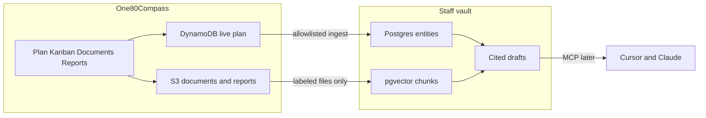

# One80Compass — Unified release plan

*Single plan for the portal product and the staff AI vault. Version 1.4 — 2026-10-27.*

This document **combines**:

1. `One80Labs_Portal_Implementation_Plan_v7.5.md` (product release boundaries and workstreams)
2. The AI vault architecture Cursor plan (Compass owns live work + staff Postgres vault)

Use this file as the release plan. The v7.5 implementation plan remains historical reference; the Cursor plan mirrors the todos below for agent execution.

---

## Status at a glance

| Area | Status |
| --- | --- |
| R1 MVP (portal core in AWS dev) | **Complete** |
| R2 Project Management + Compass ownership (Phases 1–6) | **Complete** |
| R3 vault core (Phases 7–9) — Postgres, ingest, cited draft | **Complete** (deployed) |
| R3 Phase 10 — Staff vault MCP | **Not started** (next) |
| R3 backlog — ingest UI, scheduled ingest, richer ontology | **Not started** |
| R1 pilot / first external customer gate | **Not started** |
| Security hardening follow-ups (Oct 2026 review) | **Complete** in code (deploy + PEM rotate still ops) |
| Gantt dependency enhancements (post-v1) | **Not started** |
| R4 Recovery & Governance | **Not started** |

---

## 1. Delivery objective

Ship a secure, customer-ready One80Compass portal (Documents, Project Plan, Kanban, Status Reports) and a **staff-only** AI vault that can cite filed evidence. Deliver in thin vertical slices. Advanced capabilities stay on the committed backlog, not MVP blockers.

Customers do not log into the vault. A per-customer AI feature is a later release.

---

## 2. Architecture decisions (current)

| Topic | Decision |
| --- | --- |
| Live plan | DynamoDB (`one80compass-dev`). After import, a project may be `recordSource: compass` and stop writing back to GitHub Projects. |
| Code host | Git repository, PRs, and CI stay on GitHub. |
| GitHub Projects | Source only while `recordSource` is `github`. Optional sync; no write-back after Compass owns the project. |
| Staff vault | Aurora PostgreSQL Serverless v2 + pgvector. Rebuildable copy of allowlisted programs + labeled filed files. |
| Vault IAM | Vault Lambda holds Data API / secret / Bedrock. API may only `InvokeFunction` the vault Lambda. |
| Drafts | Cited status drafts do not change live plan dates or status. Humans review before publish. |
| Tenant isolation | Every vault row keeps `customerId` and `programId` (Compass project id). |

ADRs: [0011](../adr/0011-compass-owns-live-work.md), [0012](../adr/0012-staff-vault.md). SOP: [staff-vault.md](../sop/staff-vault.md).

---

## 3. Release boundaries

| Release | In scope | Status | Exit / value |
| --- | --- | --- | --- |
| **R1 — MVP** | Cognito, tenant isolation, admin, navigation, Overview, Documents, GitHub-connected plan/Kanban, progress, basic milestones, manual reports, soft delete, audit | **Complete** in AWS dev | Pilot can complete main workflows without Confluence |
| **R2 — Project Management** | Hierarchy, Gantt/timeline, dependencies, baselines, milestones, Compass-owned catalogs and full issue editor, GitHub → Compass import | **Complete** in AWS dev | Schedule usable in reviews; Compass can own live work |
| **R3 — AI & Automation** | Staff vault (Postgres, ingest, cited draft), vault MCP, allowlist/ingest UX, richer ontology | **Core complete** (7–9); **MCP and UX backlog open** | Staff AI drafts are auditable; agents can use the vault via MCP when Phase 10 ships |
| **R4 — Recovery & Governance** | Selective restore, bulk partial success, conflict retries, advanced document governance | **Not started** | Rich recovery without overwriting active work |

---

## 4. Completed work

### A — Foundation & Security (R1) — Complete

- [x] Repo, CDK IaC, Cognito, admin group, tenant-scoped API
- [x] React shell, protected routes, CloudFront site (https://one80compass.ai)

### B — Portal & Application Directory (R1) — Complete

- [x] Customer/project CRUD, Overview health/notes, application links

### C — Documents & Audit (R1) — Complete

- [x] S3 upload/download/folders/versions, soft delete/restore, audit
- [x] Document vault source labels (`compass-upload`, `krisp`, `fireflies`, `other`)

### D — Plan, Kanban & Compass ownership (R1–R2) — Complete

Vault-track Phases 1–6:

| Phase | Work | Status |
| --- | --- | --- |
| 1 | ADR 0011 — Compass owns live work | **Complete** |
| 2 | DynamoDB field parity (priority, labels, relationships, catalogs) | **Complete** |
| 3 | `recordSource` compass writes (no GitHub enqueue) | **Complete** |
| 4 | Admin catalog screens (Settings → Catalog) | **Complete** |
| 5 | Full Compass issue editor + label/type colors | **Complete** |
| 6 | Import GitHub project → `recordSource: compass` | **Complete** |

Also complete in app:

- [x] GitHub App sync for `recordSource: github` projects
- [x] Timeline/Gantt, dependencies, baselines, milestones, progress
- [x] Catalog colors for labels (tag border) and issue types (Gantt bar)

### E — Status Reports (R1) — Complete

- [x] Draft → submit → approve → publish; Overview integration
- [x] Publish may store report markdown in the documents bucket

### F — Staff vault core (R3) — Complete (deployed)

| Phase | Work | Status |
| --- | --- | --- |
| 7 | Aurora PostgreSQL 16.8 + pgvector, vault Lambda, schema on deploy, secret `one80compass-dev-vault` | **Complete** |
| 8 | Allowlist + ingest (plan + labeled files); API invokes vault Lambda; customer/program filter | **Complete** |
| 9 | Cited status draft (“Draft from vault”); no live-plan mutation | **Complete** |

Staff SOP: [docs/sop/staff-vault.md](../sop/staff-vault.md).

---

## 5. Open work

### G — Pilot & production readiness (R1 gate) — Not started

- [ ] Threat model tenant separation and portal-to-Lambda access
- [ ] Recovery, migration, and GitHub failure drills
- [ ] Accessibility and mobile verification pass
- [ ] Monitoring/alerts proven for critical paths
- [ ] Pilot with one test customer; retire associated Confluence links

### G2 — Security hardening follow-ups (Oct 2026 review) — Complete (code)

Code review + security scan closed Critical/High defects, then this slice landed the remaining G2 items in-repo. **Ops still required:** review the CDK change set before deploy; rotate any GitHub PEM that lived in Lambda env; flip Cognito to `Mfa.REQUIRED` on a dedicated stage/prod stack (dev stack is `OPTIONAL` with software tokens so existing users are not locked out).

| Item | Severity | Notes | Status |
| --- | --- | --- | --- |
| Cognito MFA on live DNS | Critical | Dev stack: `Mfa.OPTIONAL` + software OTP. Stage/prod must use `REQUIRED` on a stack without password-only admins | **Done** (code; REQUIRED cutover is ops) |
| GitHub secrets in Secrets Manager | Critical | Secret `one80compass-dev-github`; Lambdas read `GITHUB_SECRET_ARN`; env remains bootstrap fallback. Rotate prior PEMs after deploy | **Done** (code; rotate is ops) |
| DynamoDB query pagination | High | `queryAll` / `queryUpTo` in `services/api/src/store.ts` (shared with sync) | **Done** |
| Baseline number concurrency | High | `BASELINE_SEQ` ADD + conditional put; `409` on race | **Done** |
| Prod CORS without localhost | Medium | `BROWSER_ORIGINS` / `prodOriginsOnly` / `PROD_ORIGINS_ONLY` → only `https://one80compass.ai` (+ www) | **Done** |
| RETAIN + PITR for prod data | High | Cognito, Dynamo, documents: `RETAIN`; documents no auto-delete; Dynamo PITR on | **Done** |
| Encrypt SQS / SNS | Medium | Sync queue + DLQ SQS-managed SSE; alerts topic `alias/aws/sns` | **Done** |
| Client ID token refresh | High | `freshIdToken()` / `refreshSession()`; `api()` refreshes before fetch and once on 401 | **Done** |
| Vault chunk ids tenant-scoped | Medium | PK = `customerId:programId:documentId:versionId:index` | **Done** |
| GitHub reconcile page beyond ~1000 | Medium | Page until complete (cap ~10k); fail loudly; assignees/blockedBy truncated → fail | **Done** |
| Customer audit PII scope | Medium | Non-admins: metadata only (`before`/`after` null) on customer audit + overview activity; admins full | **Done** |
| Report approve/publish roles | Medium | Approve/publish platform-admin only; contributors draft/submit/revise | **Done** |

### H — Release backlog (R3+) — Not started

| Item | Notes | Status |
| --- | --- | --- |
| **Phase 10 — Staff vault MCP** | Cursor/Claude: allowlist, ingest, search/list chunks, optional cited draft. Admin auth; filter by customer/program; no vault secret in MCP; no live-plan writes | **Not started — next vault build** |
| Allowlist / ingest UI in Compass | Today API-only (`PUT .../vault-allowlist`, `POST .../vault-ingest`) | Not started |
| Scheduled or upload-triggered ingest | Today manual ingest only | Not started |
| Richer ontology | Populate risks, decisions, people; multi-hop retrieval | Not started |
| Customer-login AI | Separate product later | Out of scope |
| Live Krisp / Fireflies connectors | File exports only for now | Out of scope |
| GitHub export from Compass | — | Out of scope |
| Model changes to live plan | Forbidden | Out of scope |
| R4 recovery features | Per original R4 boundary | Not started |

### I — Gantt dependency enhancements (post-v1) — Not started

Hard Blocker vs soft Dependency v1 shipped (or in flight). Post-v1 backlog (also ADR 0007 Follow-ups):

| Item | Notes | Status |
| --- | --- | --- |
| Hover when lines hidden | Temporarily show a bar’s connectors / linked bars without turning the global toggle on | Not started |
| Lag / lead days | Hard Blocker successor starts N days after predecessor finish | Not started |
| Other link kinds | Start-to-start, finish-to-finish, start-to-finish | Not started |
| Critical path | Highlight across the blocker graph | Not started |
| Optional auto-reschedule on Blocker create | Offer existing dependency-review move flow; warn-only remains default | Not started |

---

## 6. Phase 10 exit criteria (next vault slice)

Build an MCP server so staff can use the vault from Cursor and Claude.

- Tools: allowlist/clear program, ingest, search or list chunks for one `customerId` + `programId`, optional cited draft
- Admin authentication only
- Never return another tenant’s rows
- Invoke vault Lambda / admin API; do not embed Aurora credentials in the MCP process
- Document Cursor and Claude Desktop registration

**Exit:** From Cursor or Claude, an admin can allowlist, ingest, and retrieve cited chunks for one program. A query for another customer returns nothing.

---

## 7. Quality gates before first external customer

- [ ] Cross-tenant reads/writes fail for APIs, S3, and vault retrieval
- [x] MFA / admin vs Contributor vs View enforced in API (dev pool MFA policy per ADR notes)
- [x] GitHub sync skips Compass-owned projects; github projects still reconcile
- [x] Document versions and soft-delete/restore
- [x] Manual and vault-assisted reports can be drafted and published
- [x] Vault ingest skips unlabeled and foreign-customer files (covered by tests)
- [ ] Backup/rollback rehearsed; monitoring and alerts tested for production bar

---

## 8. Operating rhythm

- Prefer this unified plan for sequencing. Slice work into testable capabilities with acceptance criteria.
- Track architecture in ADRs under `docs/adr/`.
- Staff vault operations: `docs/sop/staff-vault.md`.
- Push the application repo to GitHub regularly while a phase is in progress.
- GitHub Projects remains the live board only for projects still on `recordSource: github`.

---

## 9. Risks

| Risk | Mitigation |
| --- | --- |
| Direct Lambda bypass | Auth at each resource, not only portal links; authorizer-only claims (no unverified Bearer overlay) |
| GitHub vs Compass divergence | Skip GitHub sync when `recordSource` is compass; keep webhook/reconcile for github projects |
| Cross-tenant vault leaks | Filter every vault query by `customerId` and `programId`; automated tests |
| Vault cost (Aurora idle) | Serverless v2 floor; monitor ACU and Data API usage |
| MVP / R3 scope creep | Protect exit gates; MCP and ontology stay backlog until asked |
| Manual ingest drift | Document SOP; backlog scheduled ingest |
| Secrets in Lambda env / MFA off on prod DNS | Secrets Manager landed; rotate PEM after deploy; MFA.REQUIRED on dedicated stage/prod (§5 G2) |
| Silent Dynamo truncation | Mitigated by `queryAll` (§5 G2) |

---

## 10. Document map

| File | Role |
| --- | --- |
| **This file** | Unified release plan (authoritative for sequencing and completion status) |
| `One80Labs_Portal_Implementation_Plan_v7.5.md` | Historical R1–R4 product plan (superseded for sequencing by this file) |
| `One80Labs_Portal_Product_Technical_Spec_v7.5.md` | Product/tech requirements (still authoritative for product behavior) |
| `One80Labs_Portal_GitHub_Backlog_v7.5.csv` | Seed backlog (decompose new work from this plan) |
| Cursor plan `ai_vault_architecture_*.plan.md` | Same todos for agent execution; keep in sync with §4–5 |
| `docs/sop/staff-vault.md` | How staff operate the vault today |

---

## Revision

| Date | Change |
| --- | --- |
| 2026-10-27 | v1.0 Combined portal + vault plans |
| 2026-10-27 | v1.1 Marked R1, R2, and vault Phases 1–9 complete; open work listed separately |
| 2026-10-27 | v1.2 Added §5 G2 security hardening open items (Oct 2026 review) and §5 I Gantt post-v1 backlog; mirrored on One80Compass Dev in-app plan |
| 2026-10-27 | v1.3 Marked §5 G2 complete in code (infra MFA OPTIONAL, Secrets Manager, CORS/RETAIN/PITR/SSE, API pagination/baselines/audit/reports, web token refresh, vault chunk PKs, sync reconcile paging) |
| 2026-10-27 | v1.3 Marked G2 done: DynamoDB query pagination, baseline number concurrency, customer audit PII redaction, report approve/publish admin-only |
| 2026-10-27 | v1.4 Dropped §5 I “Sync soft Dependencies to GitHub” (Compass owns plan; soft deps stay portal-only) |
