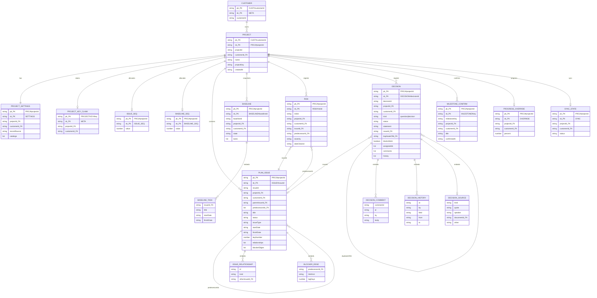

# Beginner guide — Project Plan data model (ER)

One80Compass stores the live **Project Plan** in a single DynamoDB table (`one80compass-dev` in dev). Rows share one physical primary key (`pk` + `sk`). The diagram below is the **logical** model: entities, composite keys, and application-level foreign keys.

**Related:** [Plan hierarchy](faq:plan-hierarchy) · [Baselines](faq:baselines) · [Risk Register](faq:risk-register) · [Decision Register](faq:decision-register) · [Dependencies and Blockers](faq:dependencies-blockers)

---

## Who can use this?

| Role | What you can do |
| --- | --- |
| **View** / **Contributor** / **Administrator** | Read this guide from FAQ |
| **Engineers / Cursor** | Match store keys in `services/api/src/store.ts` and domain types in `packages/domain` |

DynamoDB does **not** enforce foreign keys. Compass validates `customerId`, `projectId`, `parentIssueId`, and link ids in the API.

---

## ER diagram (logical)

---

## Primary keys (physical)

Every item uses composite **`pk` + `sk`**. Optional **GSI1** uses `gsi1pk` + `gsi1sk`.

| Entity | `pk` | `sk` | Notes |
| --- | --- | --- | --- |
| Customer | `CUST#{customerId}` | `META` | GSI1: `CUSTOMERS` / `customerId` |
| Project | `CUST#{customerId}` | `PROJ#{projectId}` | GSI1: `PROJ#{projectId}` / `META` |
| Project key claim | `PROJECTKEY#{key}` | `META` | Global unique prefix (e.g. COMP) |
| Settings | `PROJ#{projectId}` | `SETTINGS` | GSI1: `SETTINGS` / `projectId` |
| Issue | `PROJ#{projectId}` | `ISSUE#{issueId}` | Plan rows (Epic / Feature / Task / Subtask) |
| Issue sequence | `PROJ#{projectId}` | `ISSUE_SEQ` | Next `keyNumber` for COMP-N |
| Baseline | `PROJ#{projectId}` | `BASELINE#{baselineId}` | Schedule snapshot |
| Baseline sequence | `PROJ#{projectId}` | `BASELINE_SEQ` | Next baseline number |
| Risk | `PROJ#{projectId}` | `RISK#{riskId}` | Risk Register row |
| Decision | `PROJ#{projectId}` | `DECISION#{decisionId}` | Decision Register (question or decision) |
| Milestone confirm | `PROJ#{projectId}` | `MILESTONE#{key}` | Confirm/reopen history |
| Progress override | `PROJ#{projectId}` | `OVERRIDE` | One row per project |
| Sync state | `PROJ#{projectId}` | `SYNC` | GitHub sync health |

---

## Foreign keys (application-level)

| From | Attribute | To | Meaning |
| --- | --- | --- | --- |
| Most plan entities | `customerId` | Customer | Tenant |
| Most plan entities | `projectId` | Project | Plan partition |
| Project | `customerId` | Customer | Owner tenant |
| Project key claim | `projectId` | Project | Which project holds the key |
| Plan issue | `parentIssueId` | Plan issue | Hierarchy (Epic → Feature → Task) |
| Plan issue | `predecessorIds[]` | Plan issue | Hard Blockers |
| Plan issue | `relationships[].otherIssueId` | Plan issue | Soft Dependency (and other links) |
| Plan issue | `blockerEdges[].predecessorId` | Plan issue | Lag / link kind for a Hard Blocker |
| Plan issue | `priority`, `labels[]` | Settings catalogs | Catalog option ids |
| Baseline task | `issueId` | Plan issue | Snapshot of that task |
| Risk | `issueId` | Plan issue | Successor in a schedule conflict |
| Risk | `predecessorId` | Plan issue | Blocker that conflicts |
| Decision | `issueId` | Plan issue | One linked Epic / Feature / Task |
| Decision | `duplicateOfId` | Decision | Surviving row when status is duplicate |
| Decision | `source.documentId` | Document | Optional evidence document |
| Decision | `assigneeIds[]` | Membership users | People on the project |

---

## Decision fields (attributes)

One DynamoDB item is either a **question** or the **decision** that question became (`kind`). Promoting keeps the same `decisionId`.

| Field | Type | Notes |
| --- | --- | --- |
| `decisionId` | string | Logical id; also in `sk` |
| `kind` | question \| decision | Promote in place |
| `status` | outstanding \| resolved \| duplicate \| archive | |
| `statement` | string | The question or decision statement |
| `raisedBy`, `raisedOn` | string / YYYY-MM-DD | Who raised it and when |
| `assigneeIds` | string[] | Project members |
| `neededFrom` | string | Free text |
| `targetDate` | YYYY-MM-DD \| null | Answer or decide by |
| `affects` | string[] | requirements, direction, timeline, functionality, resources |
| `blocksWork` | boolean | Blocks the linked work item |
| `issueId` | string \| null | One Epic, Feature, or Task |
| `source` | object \| null | kind, quote, speaker, location, when, documentId |
| `answer` | string | Used while kind is question |
| `outcome`, `rationale` | string | Used when kind is decision |
| `decisionType` | type1 \| type2 \| null | Only on decisions |
| `decidedBy`, `decidedOn` | string \| null | Who decided and when |
| `consulted`, `assumptions`, `whatWouldChange`, `doesNotMean` | string | Guidepost fields on promote |
| `duplicateOfId` | string \| null | Pointer to surviving decision |
| `archiveReason` | string | Why archived |
| `suggestionText`, `acceptedBy` | string \| null | Reserved for suggestion inbox |
| `comments` | `{ commentId, at, by, body }[]` | Embedded thread |
| `history` | `{ at, by, field, from, to }[]` | Status / kind / assignee / … events |
| `createdAt`, `updatedAt`, `updatedBy` | string | Audit |

---

## Plan issue fields (attributes)

| Field | Type | Notes |
| --- | --- | --- |
| `issueId` | string | Logical id; also in `sk` |
| `itemId` | string \| null | GitHub Project item id |
| `number` | number \| null | GitHub issue number |
| `keyNumber` | number \| null | Action-item N in `COMP-N` |
| `title`, `description` | string | Description may be null |
| `status`, `effort` | string / number \| null | Board status and points |
| `issueState` | open \| closed | GitHub open/closed |
| `archived`, `deletedAt`, `inProject` | flags | Visibility on the plan |
| `parentIssueId` | string \| null | Tree parent |
| `issueType` | string \| null | EPIC / Feature / Task; null on Subtask |
| `milestone`, `milestoneId`, `milestoneDueOn` | string \| null | Milestone display + due |
| `startDate`, `finishDate` | YYYY-MM-DD \| null | Schedule |
| `iteration*` | mixed | Iteration title / start / duration / id |
| `assignees` | `{ id, login, name }[]` | People |
| `comments` | string \| null | Attributed comment field |
| `predecessorIds` | string[] | Hard Blocker membership |
| `blockerEdges` | `{ predecessorId, linkKind, lagDays }[]` | Optional; default FS + 0 |
| `priority` | string \| null | Catalog id |
| `labels` | string[] | Catalog ids |
| `relationships` | `{ id, kind, otherIssueId }[]` | Soft links and other kinds |
| `planOrder` | number \| null | Sibling order on Timeline |
| `updatedAt` | string | Last write |

Settings also store GitHub field maps plus catalogs: `labels`, `issueTypes`, `priorityOptions`, `milestones`, `iterations`, `statusOptions`, `columns`, `doneStatuses`, and `recordSource` (`github` \| `compass`).

---

## Concepts in one minute

| Term | Meaning |
| --- | --- |
| **Single-table** | One DynamoDB table; `entity` and `sk` prefixes separate shapes |
| **Logical FK** | App attribute that points at another row; not a DynamoDB constraint |
| **Embedded list** | Nested objects on a parent item (relationships, blockerEdges, baseline tasks, catalogs) |
| **Hierarchy** | `parentIssueId` — see [Plan hierarchy](faq:plan-hierarchy) |
| **Hard Blocker** | `predecessorIds` + optional `blockerEdges` — see [Dependencies and Blockers](faq:dependencies-blockers) |
| **Decision Register** | Separate `DECISION#` rows linked by `issueId` — see [Decision Register](faq:decision-register) |

---

## Troubleshooting

| Symptom | What to check |
| --- | --- |
| Issue missing after query | Confirm `pk` is `PROJ#{projectId}` and `sk` starts with `ISSUE#` |
| Orphan parent | `parentIssueId` must exist on the same project and not form a loop |
| Soft dep ignored by schedule | Soft links live in `relationships`, not `predecessorIds` |
| Risk id unstable | Schedule risks use `schedule:{issueId}:{predecessorId}` |
| Decision missing after query | Confirm `sk` starts with `DECISION#` under the same `PROJ#{projectId}` |
| Promote created a second row | Promote updates `kind` on the same `decisionId`; do not allocate a new id |

Code: `services/api/src/store.ts` (keys) · `packages/domain` (`PlanIssue`, `BaselineRecord`, `RiskRecord`, `DecisionRecord`, `ProjectSettings`).
